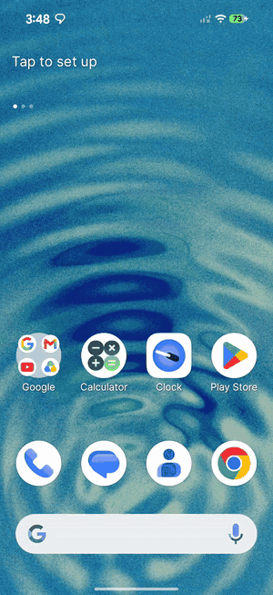
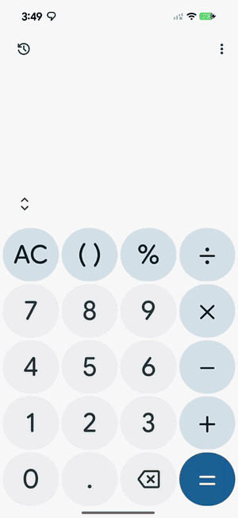
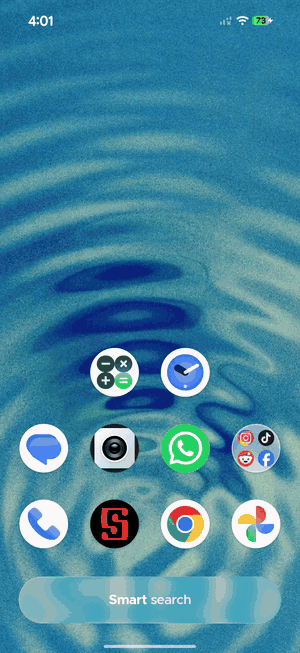
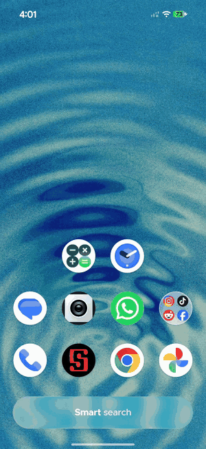
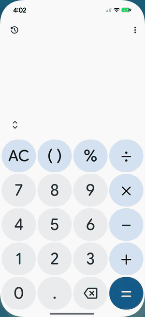
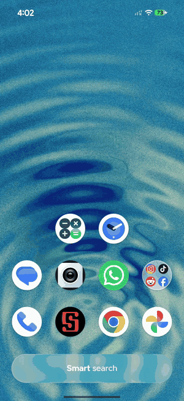

# HyperLauncher

An LSPosed module that lets HyperOS full-screen gestures work with any third-party launcher, with the stock animations.

On HyperOS, switching the default launcher away from the system one turns gesture navigation off. HyperLauncher keeps it on, and keeps the system launcher (MiuiHome) alive in the background as the gesture and recents host. Your own launcher stays the home screen. Opening and closing apps uses MiuiHome's own icon-to-window animation, aimed at the icons of your launcher.

| Open and close | Back gesture | Quick switch | Rapid open/close |
|---|---|---|---|
|  |  |  |  |

Recorded on Lawnchair.

| Open and close | Back gesture | Quick switch | Rapid open/close |
|---|---|---|---|
|  |  |  |  |

Recorded on Smart Launcher.

## What it does

- **Gesture navigation with any launcher.** Swipe up for home, swipe and hold for recents, swipe along the bottom to switch apps, back from either edge.
- **Stock open animation.** Tapping an icon in your launcher grows the app window out of that icon.
- **Stock close animation.** Closing an app shrinks its window into its icon on your home screen. Apps inside a home-screen folder close into the folder.
- **Recents from the home screen.** Dragging up on your launcher follows the finger straight into MiuiHome's recents.
- **Landscape.** Works when the launcher itself is in landscape.
- **Survives restarts.** Restores the gesture setting if the system resets it, and recovers when either launcher is killed.

## Requirements

- Xiaomi/Redmi/POCO phone on HyperOS 3 (Android 16). Built and tested on one device only: 25098PN5AC.
- Root, with LSPosed or a fork that supports the modern libxposed API (101 or newer).
- A third-party launcher set as the default home app.

Tested with Smart Launcher and Lawnchair. Other launchers should work: Launcher3-based ones are read directly, and unknown ones are learned from their view tree and from the icons you tap.

## Install

1. Install `HyperLauncher.apk`.
2. Enable the module in LSPosed and tick its scope:
   - `com.miui.home` (System launcher)
   - your launcher, for example `ginlemon.flowerfree` or `app.lawnchair`
3. Set your launcher as the default home app.
4. Open the HyperLauncher app and follow it.

## The setup screen

Opening HyperLauncher from the app drawer shows whether everything is in place:

- whether the module is running in the system launcher, and how many of its hook groups took;
- which launcher is the default, and whether the module is running in it;
- whether gesture navigation is on;
- whether the system launcher has received a picture of your home screen.

Each failing item says what it needs and, where the app can fix it, has a button: restart the system launcher, restart your launcher, turn gestures on, or open the default-launcher setting.

Restarting works in one of two ways. If the module is already running in the target, the app asks it to restart itself. If it is not (the first time, or after updating from a build older than 1.1), the app uses root, so grant HyperLauncher superuser access in your root manager, or force-stop the system launcher by hand once.

The declared scope lists Smart Launcher and Lawnchair. To use another launcher, add its package to `meta/META-INF/xposed/scope.list` and rebuild, or tick it by hand in LSPosed if your manager allows it.

If gestures do not appear, run this once and restart the system launcher:

```bash
adb shell settings put global force_fsg_nav_bar 1
```

## Build

Needs a JDK (17 or newer) and the Android SDK with build-tools 36.0.0 and platform android-36 under `~/Android/Sdk`.

```bash
./build.sh
```

The APK is written to `build/module.apk`. A debug signing key (`debug.jks`) is created on first build; it is git-ignored.

## How it works

The module runs in two places.

**Inside MiuiHome** (`Module.java`):
- Makes MiuiHome believe it is still the default home, so it builds its gesture windows and keeps its Launcher activity.
- Hides MiuiHome's own desktop and shows a picture of your launcher's home screen in its place. The picture copies the fade and zoom MiuiHome applies to its hidden desktop, so it moves as the stock home screen does.
- Replaces the close-animation target with a floating icon cut from that picture, placed where the app's icon sits in your launcher.
- Hands the screen back to your launcher after each gesture, behind a cover showing the same picture, with a window transition that jumps straight to its end state (`InstantTransition.java`).
- Passes touches made during a hand-over on to your launcher, so none are lost.

**Inside your launcher** (`IconSync.java`):
- Scans the view tree for app icons and reports their positions, with a picture of the home screen, to MiuiHome over a `Messenger`. MiuiHome only accepts messages from the current default launcher's uid.
- Intercepts app launches from icons and hands them to MiuiHome, which plays its own open animation from that icon. If MiuiHome does not answer, the launcher opens the app itself.
- Suppresses its own entrance animation when it is brought back after a gesture.

## Known differences from stock

- About 40–60 ms from finger-up to the open animation when the home screen is at rest, slightly more than stock.
- The HOME key is a plain fade.
- Apps opened from the drawer or search have no home-screen icon, so they close to the centre of the screen.
- Opening an app from a landscape home screen uses the launcher's own animation.
- Occasionally one frame where see-through home-screen elements (a glass folder or search bar) look slightly brighter at the end of a close.
- No predictive back-to-home preview. Stock HyperOS does not have one on the tested device either.

## Settings it touches

These global settings are written with the system launcher's permissions:

| Setting | Purpose |
|---|---|
| `force_fsg_nav_bar` | Re-enabled when the system turns gestures off after a launcher change. |
| `ag_wants_fsg`, `ag_last_home` | Remember that gestures were wanted and which launcher was home. |
| `ag_launch` | Set to `0` to turn off the icon-launch hand-over (`adb shell settings put global ag_launch 0`). |

## Testing

`tools/` holds the adb scripts used during development: a frame-by-frame glitch detector (`glitch.py`), a gesture scan (`scan.sh`), a 20-step battery (`bat.sh`), stress and latency tests, and landscape helpers. They assume the tested phone's screen size and a particular icon layout, record to `/tmp/w`, and need `ffmpeg`, `python3`, `numpy` and `Pillow`.

## Layout

```
AndroidManifest.xml
build.sh
libs/                 libxposed API jars
meta/META-INF/xposed/ module entry point, API level, scope
res/                  strings
src/lol/drake/hyperlauncher/
    MainActivity.java      the setup screen
    Status.java            how the setup screen asks the hooked processes what state they are in
    Module.java            MiuiHome side
    IconSync.java          launcher side, and the link between the two
    InstantTransition.java window transition that goes straight to its end state
stubs/                compile-only stand-ins for hidden framework classes
tools/                test scripts
```
